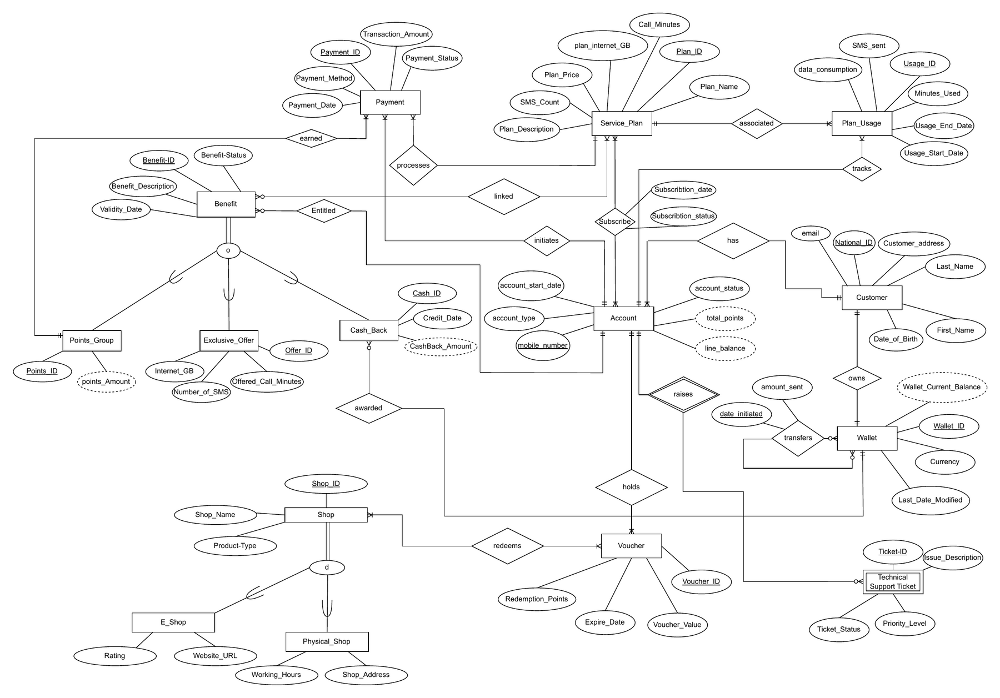

<div align="center">

# 📶 Telecom Database System

**A full database project for a mobile operator: an EERD and relational schema, a SQL Server database with 19 tables, 10 views, 15 functions and 13 stored procedures, and an ASP.NET web app for admins and customers on top of it.**

[](https://github.com/DanEhab/database-1-project/actions/workflows/sql-server.yml)


</div>

---

## The system

The database models a telecom company and its customers:

- **Customers and accounts**: profiles, mobile lines (prepaid, postpaid, pay-as-you-go), balance and loyalty points.
- **Service plans**: subscriptions, plan usage (data, minutes, SMS), payments and how much of a plan is still unpaid or overpaid.
- **Wallets**: balances and money transfers between wallets.
- **Benefits**: loyalty points, exclusive offers and cashback, linked to the plans that provide them.
- **Shops and vouchers**: e-shops and physical shops where customers redeem vouchers with their points.
- **Support**: technical support tickets with priority and status.

The project was built in three milestones:

| Milestone | Deliverable | In this repository |
|---|---|---|
| 1 | Enhanced ER diagram and relational schema | [`docs/`](docs) |
| 2 | SQL Server implementation of every table, view, function and procedure | [`database/schema.sql`](database/schema.sql) |
| 3 | Web application for admins and customers | [`web-app/`](web-app) |

---

## 1. Design (EERD)

<p align="center"></p>

The diagram uses specialisation for the three benefit types (points, exclusive offers, cashback) and the two shop types (e-shop, physical shop), a recursive *transfers* relationship between wallets, and a weak entity for support tickets. The mapped relational schema is in [`docs/relational-schema.pdf`](docs/relational-schema.pdf). The diagram is also available as a [PDF](docs/eerd.pdf) and as an editable [diagrams.net file](docs/eerd.drawio).

## 2. Database (SQL Server)

[`database/schema.sql`](database/schema.sql) creates everything:

| Object | Count | Examples |
|---|---:|---|
| Tables | 19 | `customer_account`, `Service_plan`, `Payment`, `Wallet`, `Voucher`, `Technical_support_ticket` |
| Views | 10 | `allCustomerAccounts`, `CustomerWallet`, `E_shopVouchers`, `Num_of_cashback` |
| Functions | 15 | `AccountLoginValidation`, `Remaining_plan_amount`, `Wallet_Transfer_Amount`, `Usage_Plan_CurrentMonth` |
| Stored procedures | 13 | `Initiate_plan_payment`, `Payment_wallet_cashback`, `Redeem_voucher_points`, `Total_Points_Account` |

A few details worth noting:

- **Computed columns.** `process_payment.remaining_amount` and `extra_amount` are computed by scalar functions that compare the payment with the plan price, so the remaining balance of a plan is always up to date.
- **Business rules in procedures.** `Initiate_plan_payment` records a payment and sets the subscription to *active* or *on hold* depending on whether the plan is fully paid. `Payment_wallet_cashback` credits 10% of a payment to the customer's wallet. `Redeem_voucher_points` only redeems a voucher if the account has enough points and the voucher hasn't expired.
- **Constraints.** Check constraints restrict account types, statuses and payment methods, and composite keys model the weak entities.

[`database/examples.sql`](database/examples.sql) has an example call for every object.

### Tested on every push

[`tests/smoke_test.sql`](tests/smoke_test.sql) loads a small, consistent data set and checks the result of **every** view, function and procedure (for example, that a 300 EGP payment activates a 300 EGP plan, or that redeeming a voucher deducts exactly its points). GitHub Actions runs it on a real SQL Server 2022 container:

```
PASS  10 views
PASS  15 functions (including the two used by computed columns)
PASS  12 stored procedures (plus createAllTables)
All checks passed.
```

## 3. Web application (ASP.NET Web Forms)

[`web-app/`](web-app) is an ASP.NET Web Forms app (.NET Framework 4.8, C#) with 39 pages. Every page calls the database through the views, functions and procedures above, using parameterised commands.

| Admin | Customer |
|---|---|
| Customer profiles and active accounts | Login with mobile number and password |
| Accounts subscribed to a plan on a date | Service plans and plans not yet subscribed |
| Wallets, linked wallets and transfer averages | Usage this month and total consumption |
| Payments, points and cashback transactions | Active benefits and SMS offers |
| E-shop and physical-store vouchers | Remaining and extra amount of a plan |
| Resolved tickets, removing benefits, updating points | Recharge balance, renew a subscription, redeem a voucher, get cashback |

---

## Run it

**Database** (SQL Server or LocalDB):

```sql
CREATE DATABASE Milestone2DB_24;
-- then run database/schema.sql, and optionally tests/smoke_test.sql for sample data
```

**Web app** (Windows, Visual Studio 2022):

1. Open `web-app/WebApplication1.sln`. NuGet restores the packages on the first build.
2. The connection string in `Web.config` points to `(localdb)\MSSQLLocalDB`, database `Milestone2DB_24`. Change it if your server is different.
3. Press <kbd>F5</kbd>. The admin demo login is `admin123` / `pass123`, and customers log in with a mobile number and password from `customer_account`.

---

## Team & course

Built for **CSEN501 Databases I**, German University in Cairo, Winter 2024 (Dr. Mervat Abuelkheir). Team 120:

Daniel Ehab (team lead) · Mariam Elhariry · Yasmin Abdelaziz · Youssef Yasser · Nedal Sameh
